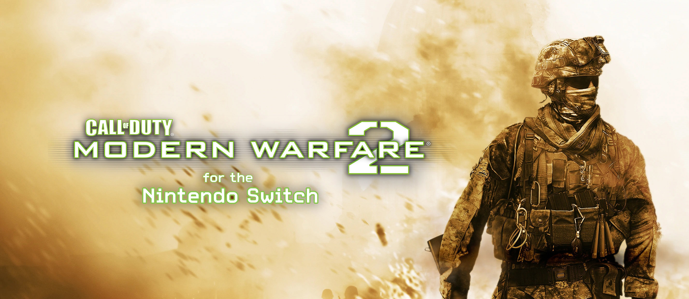

<p align="center">
  
</p>

<p align="center">
  <b>Call of Duty: Modern Warfare 2 for the Nintendo Switch, recompiled from the Xbox 360.</b><br>
  Multiplayer and Campaign in one installable game, running as native code.
</p>

<p align="center">
  
  
  <a href="LICENSE"></a>
</p>

<p align="center">
  <a href="https://ko-fi.com/S2G42AM6S8"></a>
</p>

---

mw2nx is a static recompilation of Modern Warfare 2 (Xbox 360, version 1.0.557 with Title Update 6). The game's
PowerPC code is translated ahead of time into C++ and compiled for the Switch's ARM cores, so nothing is emulated while
you play, and a Vulkan renderer of its own draws the game through Mesa's NVK driver.

Version 1.0.0 is an installable NSP: one game on the HOME menu that holds both the Campaign and Multiplayer and
switches between them from the game's own menus.

> [!IMPORTANT]
> **No game data is included, and none ever will be.** You need your own Xbox 360 disc of Modern Warfare 2 as an ISO.
> Every step that reads your files writes into folders the repository ignores; what it produces is yours alone and must
> not be shared.

## Contents

[Features](#features) · [Installing](#installing) · [Playing](#playing) · [Script mods](#script-mods) ·
[How it works](#how-it-works) · [Warnings](#warnings) · [Credits](#credits) · [License](#license) ·
[Technical documentation](#technical-documentation)

## Features

### Game modes

| Mode | What you get |
|---|---|
| **Campaign** | The whole single-player game, played through on hardware |
| **Multiplayer** | Private matches and System Link, with bots from the bundled Bot Warfare mod |

Both live in one application. The Campaign menu's Multiplayer entry (and Multiplayer's way back) starts the other
program, as the Xbox 360's executables did.

### Graphics and performance

- **Presets** `high`, `medium`, `low` and `very_low` (the default), which set the game's own quality settings, a draw
  distance, the detail of distant models and, on `very_low`, the hiding of small far-away props. Each can be overridden
  in the settings file.
- **Native code**: about 19,800 game functions compiled to ARM64 with LTO and PGO, direct calls between them, and hot
  game code (memory copies, culling, the Campaign's job-queue scan) replaced by hand-written native code.
- **Pipeline cache**: each level compiles its Vulkan pipelines the first time it is played and starts warm after that;
  lists for the Campaign's levels ship with the port.
- **Scene resolution** 75 % in the Campaign and 70 % in Multiplayer by default, scaled to 1280x720; `mw2mp_scene_scale`
  changes it. FXAA is on by default in the Campaign.
- **All four CPU cores**, because the installed game is an application with the console's full memory.

### Mods

- **Script mods**: plain `.gsc` mods made for CoD Xe load in Multiplayer; IW4 Bot Warfare ships with the port and is on by
  default. See [docs/script-mods.md](docs/script-mods.md).

Settings and their file: [docs/features.md](docs/features.md).

## Installing

**You need:**

- Your Xbox 360 disc of Modern Warfare 2, version 1.0.557 (USA/Europe), as an ISO.
- **Title Update 6.** The setup tool downloads it after it has checked your ISO.
- A Switch that runs homebrew (custom firmware such as Atmosphère) and a way to install an NSP.
- A Linux or WSL2 PC. The NSP holds no game data, so the files and the shader libraries are made from your own disc on
  this PC. Building them takes the tools in [docs/building.md](docs/building.md).

Steps, from the repository root:

1. **Install the NSP** (`mw2nx-1.0.0-[01F2D6C0A9E40000].nsp` from the release) on the console.
2. **Set up the game files.** Put your ISO in `iso/` and run `python tools/install/tu6_setup.py`. It checks the disc,
   fetches Title Update 6 and fills `work/load_tu6/`.
3. **Stage the SD card.** `python tools/stage_sd_mw2mp.py` extracts your disc and the update into a `switch/mw2mp/`
   folder.
4. **Build the shader libraries** from your own disc with `tools/mw2shaders/build_mw2mp_shaders.sh <work folder>`
   (`MW2_SP=1` for the Campaign's). They are derived from the game and never shared.
5. **Copy to the console.** Put the contents of the staged `switch/mw2mp/` folder (`game/`, `update/`, `mods/`,
   `pipelines/`) and both shader libraries into the game's own folder on the SD card:
   `sdmc:/atmosphere/contents/01F2D6C0A9E40000/`.
6. Start **Call of Duty: Modern Warfare 2** from the HOME menu. On its first start the game makes that folder and, while
   files are missing, lists what to copy where; it checks again every few seconds and starts once everything is there.

The game's folder on the SD card:

```text
sdmc:/atmosphere/contents/01F2D6C0A9E40000/
├── game/                      your disc files and Title Update 6's .xexp files
├── update/                    the rest of Title Update 6
├── mw2mp_shaders.spvpack      Multiplayer shaders, and its index (.spvidx)
├── mw2sp_shaders.spvpack      Campaign shaders, and its index (.spvidx)
├── pipelines/                 per-level pipeline lists
├── mods/bot_warfare/          the bundled script mod
├── mw2mp.toml, mw2sp.toml     settings (optional, you write them)
├── cache/                     pipeline caches, made by the game
└── logs/                      one numbered log per run
```

Profile, settings and saves are the console's own save data for the game, so they follow the Switch user and show up in
the save manager. The installed game never reads `sdmc:/switch/`.

**Building the NSP yourself** (and running the programs as plain NROs from the Homebrew Menu for development) is in
[docs/building.md](docs/building.md).

## Playing

- **Clocks.** The game runs best at CPU 1785 / GPU 614 / memory 2133 MHz. That is fast without running the console hot.
  If you use sys-clk, add a profile for **both** program IDs, `01F2D6C0A9E40000` (Campaign) and `01F2D6C0A9E40001`
  (Multiplayer); without one Multiplayer runs at the stock docked clocks and loses about half its frame rate.
- **Switching modes** takes the same time as starting a game: the other program loads when you choose it.
- **First map load.** A level compiles its pipelines the first time you visit it; expect a longer load and some hitches
  then. The pipeline cache makes every later visit faster.
- **Multiplayer.** Start a private match and press D-pad Down for Bot Warfare's menu. The Switch user's nickname is the
  player's name (`mw2mp_user_name` overrides it).

## Script mods

Multiplayer loads GSC mods made for CoD Xe. Put a mod's folder in the game's `mods/` folder, name it in `mw2mp.toml`
with `mw2mp_mod = "<name>"`, and start Multiplayer. `mw2mp_mod = ""` plays without mods. Folder layouts, the functions
added for mods and Bot Warfare's menu: [docs/script-mods.md](docs/script-mods.md).

## How it works

The Xbox 360's executable is decrypted and patched to Title Update 6, then ReXGlue's code generator turns all of its
PowerPC code into C++, which is compiled into a native Switch program. A runtime built on the ReXGlue SDK stands in
for the 360's kernel and system libraries: threads, memory, files, audio, controllers and networking. The game's own
Direct3D layer still writes its commands for the Xbox 360's GPU; a native Vulkan renderer reads them and draws each
frame on the Switch's GPU. The game's shaders are translated to SPIR-V when you build, from your own disc. The details:
[docs/technical.md](docs/technical.md).

## Warnings

- **Memory.** One heap backs the GPU's memory, the stacks and the caches, so running out of it can crash the game. The
  installed game gets the console's full memory; do not run it with other homebrew resident in the background.
- **Crashes.** Atmosphère writes a crash report to `sdmc:/atmosphere/crash_reports/`. Attach it and the newest file in
  `logs/` to a bug report.
- **Sleep.** Leaving the game in sleep mode for a long time might cause problems. Close it first if you will be away.
- **Known issues.** Load and checkpoint hitches remain in the Campaign's heaviest levels, and black textures can show on
  the first map load of a session. See [docs/MW2.md](docs/MW2.md#known-issues).

## Credits

- The Switch runtime, renderer and tooling are based on [bo2-360-nx](https://github.com/AlvaroEPena/bo2-360-nx) by
  AlvaroEPena.
- MW2 addresses, engine fixes and rendering notes come from
  [mw2-recompiled](https://github.com/PaulCombal/mw2-recompiled) by PaulCombal.
- Multiplayer bots are [IW4 Bot Warfare](https://github.com/ineedbots/iw4_bot_warfare) by INeedGames, in the
  Xbox 360 port by [CoD Xenon](https://github.com/codxenon/iw4-bot-warfare-xenon), shipped unmodified.
- Built on the [ReXGlue SDK](https://github.com/rexglue/rexglue-sdk), Xenia and mesa-switch. Every upstream project and
  library with its license is listed in [THIRD_PARTY_NOTICES.md](THIRD_PARTY_NOTICES.md).

## License

GPL-3.0 ([LICENSE](LICENSE)); bundled upstream code keeps its own notices, listed in
[THIRD_PARTY_NOTICES.md](THIRD_PARTY_NOTICES.md).

Call of Duty and Modern Warfare are trademarks of Activision Publishing, Inc. Nintendo Switch is a trademark of
Nintendo. Xbox 360 is a trademark of Microsoft. This project is not affiliated with or endorsed by any of them, and it
contains no game data.

## Technical documentation

How the port works, what was optimized and what it gained, and building from source:
**[docs/technical.md](docs/technical.md)** and **[docs/building.md](docs/building.md)**.
